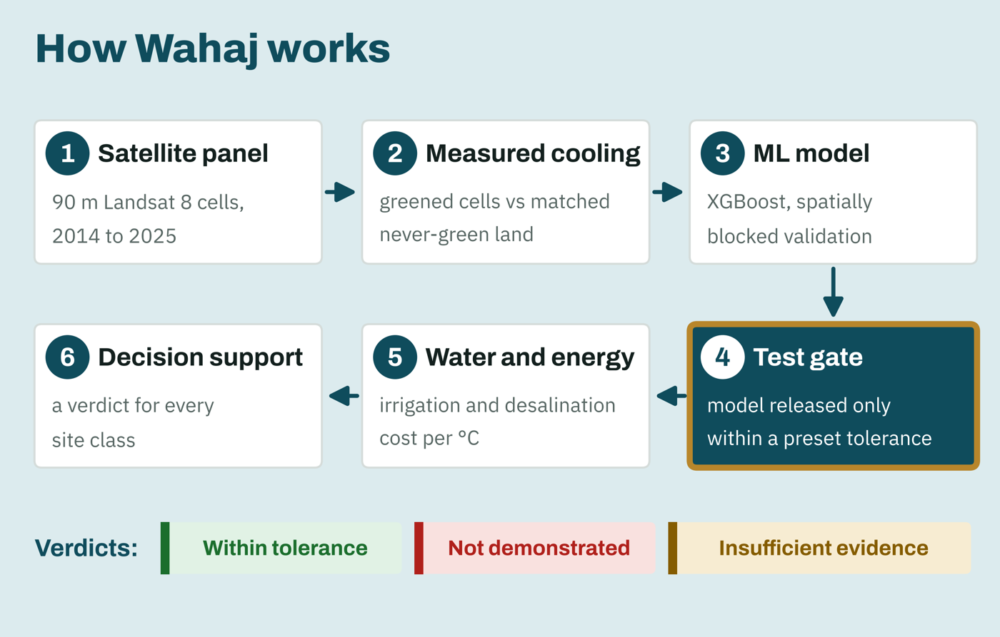

<div align="center">

# Wahaj &nbsp;وهاج

**Satellite evidence before city greening decisions**

[](https://nelmkt.github.io/Wahaj-Framework/demo/)
[](https://doi.org/10.5281/zenodo.23168529)
[](LICENSE)

[](https://www.python.org/)
[](https://xgboost.readthedocs.io/)
[](https://earthengine.google.com/)
[](docs/TECHNICAL_DETAILS.md#tests-and-checks)
[](https://orcid.org/0009-0007-9887-0280)

[](https://nelmkt.github.io/Wahaj-Framework/demo/)

</div>

## What Wahaj does

Hot cities plant trees to cool down, but in Jeddah every tree runs on desalinated seawater, which costs energy. Wahaj is a remote sensing and machine learning framework that **measures how much greening really cools a city**, **weighs that cooling against its water and energy cost**, and **uses a model's "what if we plant here?" predictions only where they pass a test against the measured cooling**.

Applied to Jeddah, it found that an accurate model can still be wrong about planting, and its test gate caught it.

## How it works



1. **Satellite panel.** Landsat 8 composites on 90 m cells, 2014 to 2025, built in Google Earth Engine.
2. **Measured cooling.** Each greened cell is compared with matched land that never greened (matched difference-in-differences with spatial-block resampling).
3. **ML model.** XGBoost predicts land surface temperature, validated on held-out spatial blocks.
4. **Test gate.** The model is used only where its error stays inside a tolerance set in advance, on cells inside its data support.
5. **Water and energy.** Irrigation and desalination energy behind each degree of cooling.
6. **Decision support.** Every site class gets a verdict: within tolerance, not demonstrated, or insufficient evidence.

## Key results for Jeddah

| | Result |
| --- | --- |
| Measured cooling | **−1.18 °C** per greened 0.09 ha pixel, 1,006 matched cells (95% CI −1.25 to −0.93); placebo before greening **−0.05 °C** |
| Model accuracy | XGBoost **R² 0.795**, RMSE 1.18 °C on 19,650 held-out cells, the best of four regressors |
| Model on planting | Under-predicts measured cooling by **+1.0 to +7.2 °C**; only **14 of 744** test cells lie inside its data support |
| Gate decision | The model was withheld, so no model-based scenario was released |


*Left: the model predicts temperature well on held-out areas. Right: it falls further short of the measured cooling as more of a cell is greened. Every number traces to a table in [`REPRODUCE.md`](REPRODUCE.md).*

## Run it

```bash
python -m pip install -r requirements.txt
python -c "import gzip,shutil; [shutil.copyfileobj(gzip.open(f'code/gee/{n}.gz','rb'), open(f'code/gee/{n}','wb')) for n in ('panel.csv','panel_jun_sep.csv')]"
python code/src/run_framework.py --panel code/gee/panel.csv --out .
python -m pytest code/src -p no:cacheprovider
```

Work in a copy: the pipeline writes tables and figures. Earth Engine is only needed to re-export the panel. Full steps are in [Technical details](docs/TECHNICAL_DETAILS.md#reproduction).

## Repository map

```
code/gee/        Earth Engine export scripts and the saved exports
code/src/        framework modules (fw_*.py), analyses, figures and tests
tables*/         result tables
figures_*/       figures (PNG and PDF)
docs/            technical details, file guide, data notes, audits and the demo
manuscript/      superseded drafts that the tests read
```

| If you want | Open |
| --- | --- |
| The idea in two minutes | The [live demo](https://nelmkt.github.io/Wahaj-Framework/demo/) |
| Every reported number, traced to its table and script | [`REPRODUCE.md`](REPRODUCE.md) |
| Full results, methods notes, tests and data | [`docs/TECHNICAL_DETAILS.md`](docs/TECHNICAL_DETAILS.md) |
| What each file is | [`docs/FILE_GUIDE.md`](docs/FILE_GUIDE.md) |

Files ending in `_v2`, `_v3_oldrecipe`, `_prior`, `_INVALID` or `_PRINTFAIL` are superseded versions kept on purpose as an audit trail. The audit scripts and checksum manifests refer to them, so they stay in place.

## Scope and limits

- Land surface temperature, not air temperature or comfort.
- Water and energy figures use assumed irrigation, not metered records.
- One city so far. The workflow adapts to other hot, arid cities; Jeddah's numbers do not transfer.
- See [Interpretation and portability](docs/TECHNICAL_DETAILS.md#interpretation-and-portability) for the full list.

## Citation

```bibtex
@software{almaktoum_wahaj_2026,
  author  = {Almaktoum, Nelly F.},
  title   = {Wahaj: A Remote Sensing and Machine Learning Framework for Evaluating Urban Greening--Energy Trade-Offs in Desalination-Dependent Cities, with a Jeddah Case Study},
  year    = {2026},
  version = {2.3.1},
  doi     = {10.5281/zenodo.23168530},
  url     = {https://github.com/nelmkt/Wahaj-Framework}
}
```

GitHub also shows this under "Cite this repository", from [`CITATION.cff`](CITATION.cff).

## Licence and contact

Code and files are released under the [MIT License](LICENSE), © 2026 Nelly F. Almaktoum. Satellite and other source data stay under their providers' terms; see [`docs/DATA.md`](docs/DATA.md).

**Nelly F. Almaktoum**, King Abdulaziz University, Jeddah
[nalmaktoum0001@stu.kau.edu.sa](mailto:nalmaktoum0001@stu.kau.edu.sa) | [ORCID](https://orcid.org/0009-0007-9887-0280) | [Issues](https://github.com/nelmkt/Wahaj-Framework/issues)
