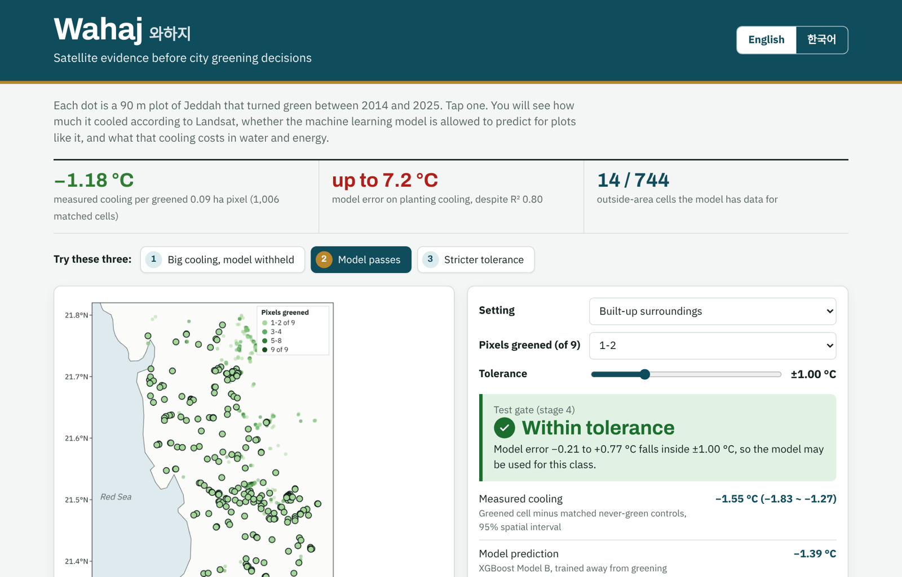
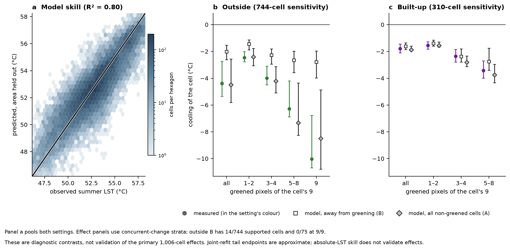

<div align="center">

# Wahaj&nbsp;وهاج

Checking satellite evidence before a city decides where to plant

[](https://nelmkt.github.io/Wahaj-Framework/demo/)
[](https://doi.org/10.5281/zenodo.23168529)
[](LICENSE)

[](https://nelmkt.github.io/Wahaj-Framework/demo/)

</div>

## Why I built this

Jeddah is hot, and planting trees is one of the usual ways cities try to cool down. The catch here is water: almost every tree in Jeddah is irrigated with desalinated seawater, and desalination takes a lot of energy. So before planting more, it's worth knowing how much cooling greening actually buys, and what it costs.

Wahaj is my attempt at answering that with satellite data. It measures the cooling that greening has already produced, puts a water and energy cost on it, and only trusts a machine learning model's "what if we plant here?" answers if they agree with what was measured.

The most interesting result was a failure. The model I trained was accurate at predicting temperature, but it was wrong about planting, and the check I built into the framework caught that before any of its scenarios were used.

## How it works


I start from a Landsat 8 panel on 90 m cells covering 2014 to 2025, built in Google Earth Engine. For every cell that became greener, I compare it with similar land that never did (a matched difference-in-differences, resampled by spatial blocks), which gives the measured cooling.

Separately, an XGBoost model predicts land surface temperature and is validated on spatial blocks it never saw. Before its planting predictions can be used anywhere, they have to land within a tolerance I fixed in advance, and only on cells that look like the data it was trained on. Then I convert each degree of cooling into irrigation water and desalination energy, and give every type of site one of three verdicts: within tolerance, not demonstrated, or not enough evidence.

## What it found in Jeddah

Greening cooled the ground by about 1.18 °C per greened 0.09 ha pixel, measured across 1,006 matched cells (95% CI −1.25 to −0.93 °C). The same comparison before any greening happened gives −0.05 °C, which is what you'd hope for.

The model did well on its own terms: R² 0.795 and an RMSE of 1.18 °C on 19,650 held-out cells, the best of the four regressors I tried. But when I asked it about planting, it under-predicted the measured cooling by +1.0 to +7.2 °C, and only 14 of the 744 test cells were inside the range of data it had learned from. So the gate held it back, and no model-based planting scenario was released.



*Left: the model predicts temperature well on areas it hasn't seen. Right: it falls further behind the measured cooling the more of a cell is greened. Every number in this README traces back to a table in [`REPRODUCE.md`](REPRODUCE.md).*

## Running it

```bash
python -m pip install -r requirements.txt
python -c "import gzip,shutil; [shutil.copyfileobj(gzip.open(f'code/gee/{n}.gz','rb'), open(f'code/gee/{n}','wb')) for n in ('panel.csv','panel_jun_sep.csv')]"
python code/src/run_framework.py --panel code/gee/panel.csv --out .
python -m pytest code/src -p no:cacheprovider
```

It needs Python 3.12. Run it in a copy of the repo, since the pipeline writes its tables and figures in place. You only need Earth Engine if you want to re-export the satellite panel yourself. The full steps are in [Technical details](docs/TECHNICAL_DETAILS.md#reproduction).

## Finding your way around

```
code/            Earth Engine exports (gee/), framework and analyses (src/), earlier index module
tables/          result tables, with revision_r1/ and revision_v11/ for the revision tables
figures/         figures as png/ and pdf/, with r1/ for the revision figures
docs/            technical details, file guide, data notes, audits and the demo
manuscript/      superseded drafts that the tests read
```

If you just want the idea, try the [live demo](https://nelmkt.github.io/Wahaj-Framework/demo/). For every reported number and the script behind it, see [`REPRODUCE.md`](REPRODUCE.md). Methods notes, tests and data sources are in [`docs/TECHNICAL_DETAILS.md`](docs/TECHNICAL_DETAILS.md), and [`docs/FILE_GUIDE.md`](docs/FILE_GUIDE.md) explains what each file is.

You'll see files ending in `_v2`, `_v3_oldrecipe`, `_prior`, `_INVALID` or `_PRINTFAIL`. Those are older versions I kept on purpose as an audit trail; the audit scripts and checksum manifests point to them, so please leave them where they are.

## What it doesn't do

It measures land surface temperature, not air temperature or how comfortable people feel. The water and energy numbers rely on assumed irrigation rates rather than metered records. And it has only been applied to Jeddah so far: the workflow should carry over to other hot, dry cities, but Jeddah's numbers won't. There's more on this under [Interpretation and portability](docs/TECHNICAL_DETAILS.md#interpretation-and-portability).

## Citing

```bibtex
@software{almaktoum_wahaj_2026,
  author  = {Almaktoum, Nelly F.},
  title   = {Wahaj: A Remote Sensing and Machine Learning Framework for Evaluating Urban Greening--Energy Trade-Offs in Desalination-Dependent Cities, with a Jeddah Case Study},
  year    = {2026},
  version = {2.3.1},
  doi     = {10.5281/zenodo.23168530},
  url     = {https://github.com/nelmkt/Wahaj-Framework}
}
```

You can also use "Cite this repository" on GitHub, which reads [`CITATION.cff`](CITATION.cff).

## Licence and contact

The code and files are under the [MIT License](LICENSE), © 2026 Nelly F. Almaktoum. Satellite and other source data stay under their providers' terms (see [`docs/DATA.md`](docs/DATA.md)).

I'm Nelly F. Almaktoum, at King Abdulaziz University in Jeddah. Questions and suggestions are welcome by [email](mailto:nalmaktoum0001@stu.kau.edu.sa) or through [issues](https://github.com/nelmkt/Wahaj-Framework/issues), and my ORCID is [0009-0007-9887-0280](https://orcid.org/0009-0007-9887-0280).
